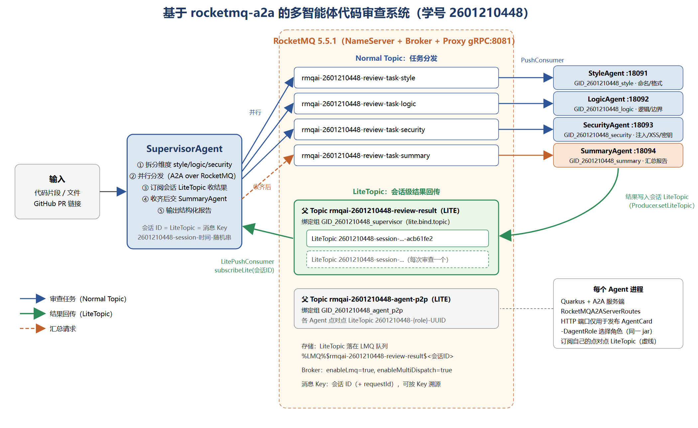

# 基于 rocketmq-a2a 的多智能体代码审查系统

Apache RocketMQ 开源实践课 · 进阶题目 3 · 学号 2601210448

SupervisorAgent 接收代码片段、文件或 GitHub PR 链接，拆成风格、逻辑、安全三个维度，通过 **A2A over RocketMQ** 并行分发给 StyleAgent、LogicAgent、SecurityAgent。三者把结果回传到 Supervisor 本次会话的 **LiteTopic**，Supervisor 收齐后交给 SummaryAgent，生成结构化 Review 报告。



## 1. Agent 拓扑

| Agent | 职责 | 进程 / 端口 | 实现 |
|---|---|---|---|
| SupervisorAgent | 接收输入、拆分维度、并行分发、收集结果、调用汇总 | 命令行程序 | A2A Client + `RocketMQTransport` |
| StyleAgent | 命名规范、格式、通配符导入、日志使用、大括号 | :18091 | Quarkus + `RocketMQA2AServerRoutes` |
| LogicAgent | 空 catch、字符串 ==、NPE、循环越界、资源泄漏、整数除法、浮点比较 | :18092 | 同上 |
| SecurityAgent | SQL 注入、XSS、硬编码密钥、命令注入、路径穿越、弱哈希、不安全随机数、反序列化 | :18093 | 同上 |
| SummaryAgent | 汇总评分、给出合并结论、按严重度列问题、标记多 Agent 交叉命中的行 | :18094 | 同上 |

四个审查 Agent 是同一个 jar，启动时用 `-DagentRole` 选择角色。HTTP 端口只用来发布 AgentCard 供 Supervisor 发现，真正的请求和响应都走 RocketMQ。

审查逻辑是规则引擎（`review-common`），共 30 条规则，不调用大模型，结果可复现，有 6 个单元测试覆盖。

## 2. Topic 规划

| 资源 | 类型 | 用途 |
|---|---|---|
| `rmqai-2601210448-review-task-style` | Normal Topic | 风格审查任务 |
| `rmqai-2601210448-review-task-logic` | Normal Topic | 逻辑审查任务 |
| `rmqai-2601210448-review-task-security` | Normal Topic | 安全审查任务 |
| `rmqai-2601210448-review-task-summary` | Normal Topic | 汇总任务 |
| `GID_2601210448_style / logic / security / summary` | 普通消费者组 | 各 Agent 订阅自己的任务 Topic |
| `rmqai-2601210448-review-result` | LiteTopic 父 Topic（`message.type=LITE`） | 会话级结果回传 |
| `GID_2601210448_supervisor` | Lite 消费者组（`lite.bind.topic=rmqai-2601210448-review-result`） | Supervisor 订阅本次会话 |
| `rmqai-2601210448-agent-p2p` | LiteTopic 父 Topic | 各 Agent 的点对点 LiteTopic（SDK 的 sticky 路由） |
| `GID_2601210448_agent_p2p` | Lite 消费者组 | 各 Agent 订阅自己的点对点 LiteTopic |
| `2601210448-session-{时间}-{随机串}` | LiteTopic（会话） | 每次审查一个，同时作为 A2A contextId |
| `2601210448-{role}-{UUID}` | LiteTopic（点对点） | 每个 Agent 实例一个 |

**为什么任务用 Normal Topic、结果用 LiteTopic：** 任务需要被某个审查 Agent 的消费者组可靠消费，是典型的队列场景；结果只属于发起它的那一次会话，用 LiteTopic 可以让每个会话拥有独立的轻量队列，Supervisor 只订阅自己的会话，不会收到别人的结果，也不需要为每次审查创建一个真正的 Topic。

**为什么每个审查维度一个 Normal Topic：** A2A 是请求-响应语义，一条请求只应由一个 Agent 处理并回一条响应。如果三个 Agent 用不同消费者组订阅同一个 Topic，每个 Agent 都会收到所有请求并各回一条响应，请求和响应无法一一对应。

**命名规范：** 所有资源带学号；会话 LiteTopic 以学号开头；消息 Key = 会话 ID（请求还带 requestId），可以用 `queryMsgByKey` 把一次会话的全部消息查出来。

## 3. 消息流转（一次审查）

1. Supervisor 生成会话 ID `2601210448-session-...`，通过 HTTP 取 4 个 AgentCard，card.url 形如 `rocketmq://127.0.0.1:8081//rmqai-2601210448-review-task-style`。
2. Supervisor 用 `LitePushConsumer.subscribeLite(会话ID)` 订阅结果 LiteTopic。
3. Supervisor 并行发送 3 条 A2A `message/send` 请求，分别写入 3 个 Normal Topic，消息 Key 为会话 ID + requestId。
4. 各 Agent 的 `PushConsumer` 消费请求，执行审查，把带完整 Task 的响应写入 `rmqai-2601210448-review-result` 下的会话 LiteTopic（Broker 内为 LMQ 队列 `%LMQ%$rmqai-2601210448-review-result$<会话ID>`）。
5. Supervisor 收齐 3 个结果，把它们打包发到 `rmqai-2601210448-review-task-summary`。
6. SummaryAgent 生成报告，同样回传到会话 LiteTopic；Supervisor 打印并保存到 `reports/<会话ID>.md`。

实测（`samples/OrderController.java`，62 行）：3 个 Agent 收到任务的时间相差 3 ms 以内，单个 Agent 处理 3～24 ms，Supervisor 端到端 0.75～1.0 s。会话 LiteTopic 中共 4 条消息（3 个结果 + 1 个报告），`GID_2601210448_supervisor` 消费进度 4/4，堆积 0。

## 4. 运行

前置：RocketMQ 5.5.1 的 NameServer、Broker、Proxy 已启动，Broker 配置中 `enableLmq=true`、`enableMultiDispatch=true`。

```powershell
# 1. 构建 (patched SDK 先安装到本地仓库, 见 sdk-patch/PATCH.md)
mvn -Dmaven.repo.local=E:\maven-repo package
# 2. 创建 Topic 和消费者组
.\scripts\create-resources.ps1 2601210448
# 3. 启动 4 个 Agent
.\scripts\start-agents.ps1 2601210448 127.0.0.1:8081
# 4. 发起审查: 文件 / PR 链接 / 代码片段
java -jar supervisor-agent\target\supervisor-agent.jar samples\OrderController.java
java -jar supervisor-agent\target\supervisor-agent.jar https://github.com/apache/rocketmq/pull/11416
```

### 连接阿里云 RocketMQ 实例

代码同样可以连阿里云云消息队列 RocketMQ 版（5.x）。先在控制台按第 2 节创建同名 Topic 和 Group，再用环境变量传入实例的用户名和密码（不写进代码和命令行）：

```powershell
$env:RMQ_ACCESS_KEY = '<实例用户名>'
$env:RMQ_SECRET_KEY = '<实例密码>'
.\scripts\start-agents.ps1 2601210448 <实例接入点>:8080
java -jar supervisor-agent\target\supervisor-agent.jar samples\OrderController.java
```

不设置这两个环境变量时为空，行为与本地开源集群一致（该路径尚未在阿里云实例上实测）。

## 5. 目录

```
code-review-agents/
├── review-common/      规则引擎 (Style/Logic/Security/Summary)、消息模型、资源命名, 含单元测试
├── review-agent/       四类审查 Agent (Quarkus + rocketmq-a2a 服务端)
├── supervisor-agent/   SupervisorAgent (A2A Client + RocketMQTransport)
├── sdk-patch/          rocketmq-a2a 1.0.9 的补丁版源码与说明
├── samples/            审查样例代码
├── scripts/            创建资源、启动 Agent、截图脚本
├── docs/               架构图源文件
├── reports/            生成的审查报告 (Markdown + JSON)
├── logs/ run-logs/     运行日志与截图用的日志
└── screenshots/        截图
```
